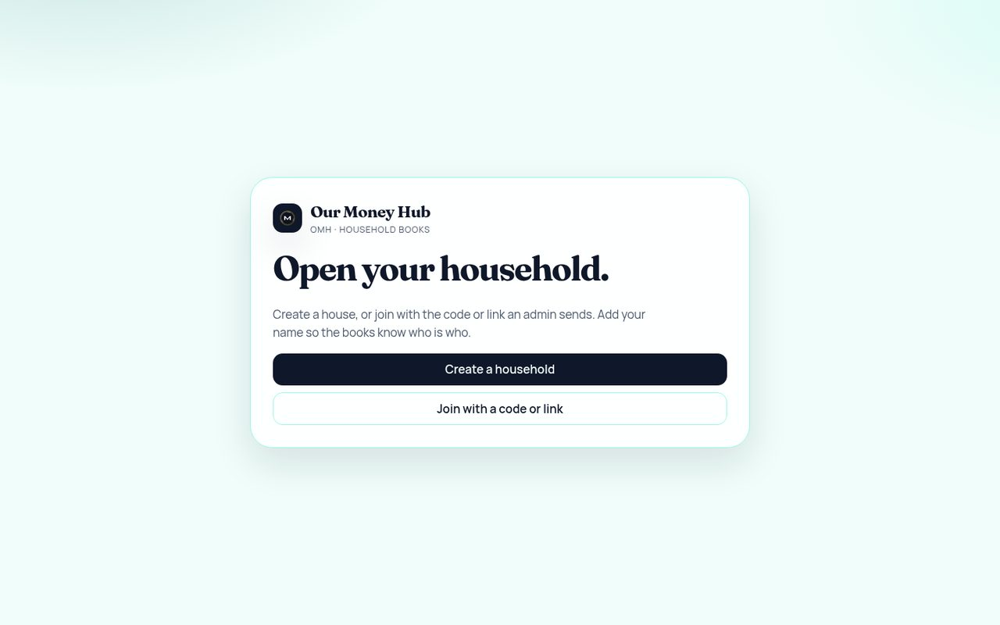

# Our Money Hub (OMH)

Private household books. The admin creates the house and sends a join code or link. Members add their name. After that, admin and members all add lines, everyone sees the same household table on Home, and everyone can chat and open each person’s money, savings, and projects.

Default currency is Polish złoty (PLN). Data stays in the browser (IndexedDB) on the public GitHub Pages build.

[](https://arnold-rg.github.io/our-money-hub/)

**Live:** [https://arnold-rg.github.io/our-money-hub/](https://arnold-rg.github.io/our-money-hub/)

[](https://arnold-rg.github.io/our-money-hub/)

## Features

- **Admin** — creates the household, sends the invite, manages people and house settings
- **Member** — joins with the code or link, adds income, expenses, savings, and projects, chats with the house, and sees every other person’s data
- Home: totals plus one table of every household line (all people, this month)
- People: household group chat plus each member’s money, savings, and projects
- Income, expenses, other costs
- Savings pots and life projects
- Currency exchange
- Plans board and advisor
- Settings

## Tech stack

| Layer | Tools |
| --- | --- |
| App | React 19, React Router, Vite 6 |
| Storage (public site) | IndexedDB, in the visitor’s browser |
| Hosting | GitHub Pages via `.github/workflows/pages.yml` |

## Getting started

```bash
git clone https://github.com/Arnold-RG/our-money-hub.git
cd our-money-hub
npm install
npm run dev
```

Open [http://localhost:5173](http://localhost:5173).

```bash
npm run build
npm run preview
```

## Project structure

```text
client/             Vite app (HTML entry, src, public)
client/src/pages    Screens for home, people, money, savings, plans
client/src/idb.js   Browser storage
package.json        Root scripts (`dev`, `build`, `preview`)
docs/               README screenshot
```

## Tests

No automated test suite is included. Build with `npm run build`.

## Author

Arnold Rurangwa
